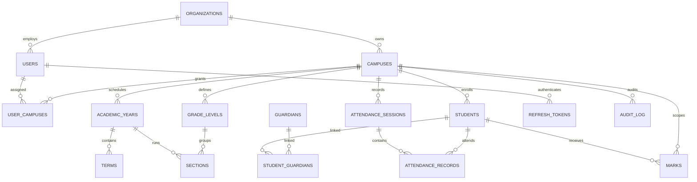

# Technical decisions and open school decisions

## Technical decisions

- Product scope: responsive web-first multi-school SaaS for independent private primary and secondary schools, limited to Grades 1–12. Kindergarten, colleges, universities and higher-education campus administration are out of scope. An organization is the school tenant; campus-scoped data refers to operational school sites, not a higher-education campus model. Server-side organization and campus membership determine access; client-provided school identifiers do not grant authorization.
- Use the approved React 18/Vite + Express/Node ES module + MySQL 8/Knex stack. Keep source in the existing `frontend/` and `backend/` workspace folders.
- Run native Node/MAMP development; do not introduce Docker.
- Ship an explicit, temporary in-memory API mode so developers can evaluate screens without first installing MySQL. Production validation refuses memory mode; MySQL remains the durable system of record.
- Keep one role per user account for this release; role grants are server-enforced and staff invitations bind the selected role. Multi-role accounts and MFA remain future enhancements. Password recovery uses configured SMTP, hashed single-use 30-minute reset tokens, and generic request responses.
- New school registrations start an active trial on the configured Starter plan immediately. Platform administrators retain audited suspension/reactivation controls; plan changes preserve the current trial or paid-period dates rather than silently resetting subscription access.
- Store Gregorian dates in the database. Conversion to Ethiopian calendar presentation occurs at UI edges. The first implementation adds a tested conversion library but not the reusable date-entry experience.
- Store the Ethiopian and Latin-script components of each student name independently; never derive a surname from another component.
- Restrict offline writes to attendance and marks and associate each queued operation with a stable client UUID.
- Attendance corrections require a meaningful reason, preserve old/new status and reason in the audit log, and are limited to campus records and assigned teacher sections. Corrections currently update the attendance record directly; a configurable late-edit window and session close/reopen policy remain undecided.
- Mark entry begins in `draft` and supports audited `submitted` → `approved` → `locked/published` transitions; the author cannot approve their own mark. Published-mark amendments require reasons, and immutable official report revisions require distinct submitter, approver, and publisher identities.
- Implement campus-scoped fee items, invoices, manual payments, receipts, reversals, cashier shifts, append-only expenses and basic income/expense summaries. Payment gateways, advanced fee policy, bank reconciliation and production financial controls remain deferred.

## School decisions still required

- Confirm grading scales, pass marks, component weights, ranking/tie policy, promotion rules and EC-to-Gregorian academic-year boundaries.
- Confirm academic years, terms, grade/stream/subject definitions, class sections, timetable and the full role/permission assignment matrix.
- Define local guardian verification, consent wording/retention, fee policy, privacy notices, sensitive data fields, retention/deletion/anonymisation periods, and incident contacts.
- Select approved SMS/email providers for general notifications and storage location only after security, privacy and legal review. SMTP is configured for password recovery only; the development default has no mail provider.
- Obtain Ethiopian legal counsel review for Personal Data Protection Proclamation No. 1321/2024 and all relevant child-data, hosting, data transfer and breach obligations before any production use.

## Mermaid overview (current initial schema)

