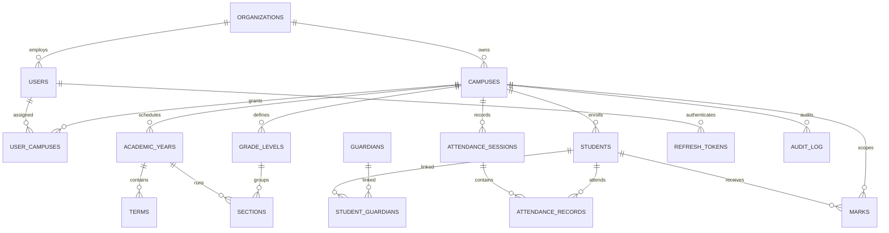

# Technical decisions and open school decisions

## Technical decisions

- Use the approved React 18/Vite + Express/Node ES module + MySQL 8/Knex stack. Keep source in the existing `frontend/` and `backend/` workspace folders.
- Run native Node/MAMP development; do not introduce Docker.
- Ship an explicit, temporary in-memory API mode so developers can evaluate screens without first installing MySQL. Production validation refuses memory mode; MySQL remains the durable system of record.
- Store Gregorian dates in the database. Conversion to Ethiopian calendar presentation occurs at UI edges. The first implementation adds a tested conversion library but not the reusable date-entry experience.
- Store the Ethiopian and Latin-script components of each student name independently; never derive a surname from another component.
- Restrict offline writes to attendance and marks and associate each queued operation with a stable client UUID.
- Keep mark writes in `draft` state. Immutable history/approval/amendment rules are not claimed to be complete.
- Preserve fee/financial operations for a later pass; no financial data is accepted by this implementation.

## School decisions still required

- Confirm grading scales, pass marks, component weights, ranking/tie policy, promotion rules and EC-to-Gregorian academic-year boundaries.
- Confirm academic years, terms, grade/stream/subject definitions, class sections, timetable and the full role/permission assignment matrix.
- Define local guardian verification, consent wording/retention, fee policy, privacy notices, sensitive data fields, retention/deletion/anonymisation periods, and incident contacts.
- Select approved SMS/email gateway providers and storage location only after security, privacy and legal review. The development default is no external provider.
- Obtain Ethiopian legal counsel review for Personal Data Protection Proclamation No. 1321/2024 and all relevant child-data, hosting, data transfer and breach obligations before any production use.

## Mermaid overview (current initial schema)

